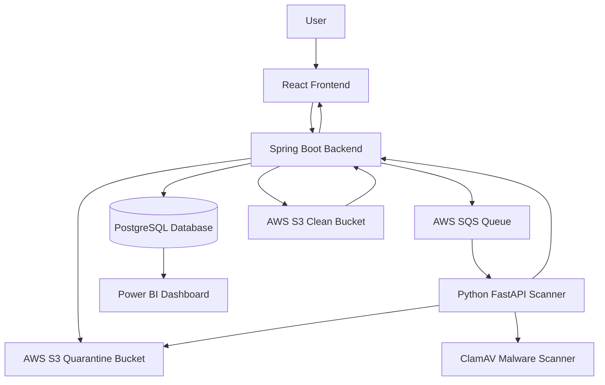
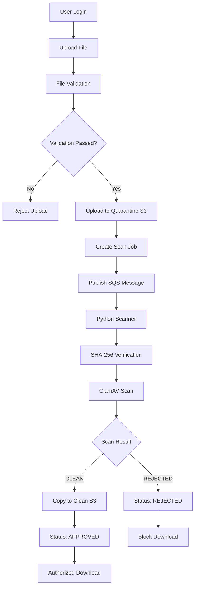

# FileNexus – Secure File Intake & Malware Scanning System

**FileNexus** is a secure file intake and malware scanning platform designed to validate, quarantine, scan, and manage uploaded files before making them available for download.

The application integrates **React, Spring Boot, Python FastAPI, PostgreSQL, AWS S3, AWS SQS, and ClamAV** to provide a secure and automated file processing workflow.

## Live Deployment

| Detail | Information |
|---|---|
| Application | FileNexus |
| Hosting Platform | AWS EC2 |
| Deployment URL | http://13.207.201.221/ | arikaleeswaran.me
| Backend | Spring Boot |
| Frontend | React + Vite |
| Database | PostgreSQL |
| Malware Scanner | Python FastAPI + ClamAV |
| Containerization | Docker Compose |

> **Note:** The application is currently accessible through its EC2 public IP. A custom domain and HTTPS configuration will be added later.

---

## Table of Contents

- [Overview](#overview)
- [Key Features](#key-features)
- [System Architecture](#system-architecture)
- [Technology Stack](#technology-stack)
- [Application Workflow](#application-workflow)
- [Security Features](#security-features)
- [User Roles](#user-roles)
- [Database Design](#database-design)
- [Project Structure](#project-structure)
- [Prerequisites](#prerequisites)
- [Local Installation and Setup](#local-installation-and-setup)
- [Environment Configuration](#environment-configuration)
- [Docker Deployment](#docker-deployment)
- [AWS Infrastructure](#aws-infrastructure)
- [Power BI Analytics](#power-bi-analytics)
- [Testing](#testing)
- [Application Screenshots](#application-screenshots)
- [Future Enhancements](#future-enhancements)
- [Author](#author)

---

## Overview

FileNexus addresses the security risks associated with accepting files from different users and external sources.

Traditional file upload systems may make uploaded files available immediately without performing sufficient validation or malware scanning. This creates potential security risks for applications and organizations.

FileNexus introduces a controlled file intake process in which every uploaded file undergoes validation, quarantine storage, checksum verification, and malware scanning before approval.

Only files that successfully pass the scanning process are released into the clean storage bucket and made available for authorized downloads.

## Key Features

### 1. User Authentication and Authorization
- Secure user registration and login.
- JWT-based authentication.
- Role-based access control.
- Password hashing using Spring Security.
- Protected application routes and APIs.

### 2. Secure File Upload
- File extension validation.
- MIME type validation.
- File signature validation.
- File size restrictions.
- SHA-256 checksum generation.
- Secure upload to AWS S3 quarantine storage.

### 3. Automated Malware Scanning
- Asynchronous scanning through AWS SQS.
- Python-based scanning service using FastAPI.
- ClamAV integration for malware detection.
- SHA-256 integrity verification.
- Automated scan result reporting.

### 4. Secure File Management
- File status tracking.
- Scan history and validation information.
- Secure file release.
- Restricted file downloads.
- Only approved files are available for downloading.

### 5. Audit Logging
- User activity tracking.
- File upload and download event logging.
- Scan activity monitoring.
- Validation event records.
- Security-related audit information.

### 6. Analytics Dashboard
- File security overview.
- File status distribution.
- Malware scanning analytics.
- User activity monitoring.
- Audit event analysis.
- Power BI dashboard integration.

---

## System Architecture

FileNexus follows a modular architecture in which the frontend, backend, scanning service, database, and AWS infrastructure work together.

### Architecture Diagram



### Component Responsibilities

| Component | Responsibility |
|---|---|
| React Frontend | User interface, authentication, file upload, and dashboard |
| Spring Boot Backend | Business logic, authentication, validation, and file management |
| PostgreSQL | Stores user information, file metadata, scan jobs, and audit records |
| AWS S3 Quarantine | Temporarily stores uploaded files awaiting scanning |
| AWS SQS | Transfers scanning jobs asynchronously |
| Python FastAPI Scanner | Processes scanning jobs and communicates with the backend |
| ClamAV | Detects malware in uploaded files |
| AWS S3 Clean | Stores files approved after successful scanning |
| Power BI | Provides security and operational analytics |

---

## Technology Stack

| Category | Technologies |
|---|---|
| Frontend | React.js, Vite, JavaScript, Tailwind CSS |
| Backend | Java 21, Spring Boot 4, Spring Security |
| Authentication | JWT |
| Database | PostgreSQL |
| ORM | Spring Data JPA, Hibernate |
| Scanner Service | Python, FastAPI |
| Malware Detection | ClamAV |
| AWS Storage | Amazon S3 |
| Messaging | Amazon SQS |
| Cloud Hosting | AWS EC2 |
| Containerization | Docker, Docker Compose |
| Reverse Proxy | Nginx |
| Analytics | Microsoft Power BI |
| Version Control | Git, GitHub |
| Testing | JUnit 5, Mockito, Spring Boot Test, Python testing tools |

---

## Application Workflow

The FileNexus file processing lifecycle consists of the following stages:

### Step 1: User Authentication
The user registers or logs in to the application. Spring Security authenticates the user and issues a JWT token.

### Step 2: File Upload
The authenticated user uploads a file through the React frontend.

The Spring Boot backend validates:
- File extension.
- MIME type.
- File signature.
- File size.
- SHA-256 checksum.

### Step 3: Quarantine Storage
After successful validation, the file is uploaded to the private AWS S3 quarantine bucket.

The file metadata and corresponding scan job are stored in PostgreSQL.

### Step 4: SQS Message Creation
The backend sends a scanning message to AWS SQS containing the required file and scan information.

### Step 5: Malware Scanning
The Python scanner consumes the SQS message and:
1. Retrieves the corresponding scan job.
2. Downloads the quarantined file.
3. Verifies the SHA-256 checksum.
4. Scans the file using ClamAV.
5. Reports the result to the Spring Boot backend.

### Step 6: File Approval or Rejection

**If the file is CLEAN:**
- The backend copies the file from the quarantine bucket to the clean bucket.
- The file status is updated to `APPROVED`.
- The file becomes available for authorized downloads.

**If the file is REJECTED:**
- The file is not released to the clean bucket.
- Its status is updated to `REJECTED`.
- The file remains blocked from normal downloads.

### Workflow Diagram



---

## Security Features

FileNexus incorporates multiple security controls to protect uploaded files and application resources.

| Security Control | Description |
|---|---|
| JWT Authentication | Protects authenticated application endpoints |
| Role-Based Access Control | Restricts functionality based on user roles |
| Password Hashing | Prevents storage of plain-text passwords |
| File Validation | Checks file extensions, MIME types, signatures, and size |
| SHA-256 | Verifies file integrity |
| Quarantine Storage | Isolates files before malware scanning |
| ClamAV | Performs malware scanning |
| Private S3 Buckets | Prevents public access to stored files |
| Scanner Authentication | Protects internal scanner-to-backend communication |
| Audit Logging | Records important application and security activities |
| Environment Variables | Keeps sensitive configuration outside source code |

---

## User Roles

FileNexus supports three application roles.

| Role | Responsibilities |
|---|---|
| ADMIN | Manages users, monitors files, and reviews application activities |
| USER | Uploads files, tracks scanning status, and downloads approved files |
| SECURITY_ANALYST | Reviews security-related scanning results and activities |

Access to application functionality is controlled through role-based authorization.

---

## Database Design

FileNexus uses PostgreSQL to maintain application and security-related information.

### Main Database Tables

| Table | Purpose |
|---|---|
| users | Stores user account information and roles |
| files | Stores uploaded file metadata and security status |
| scan_jobs | Maintains malware scanning job information |
| validation_logs | Stores file validation results |
| audit_logs | Maintains application activity records |
| file_access_logs | Tracks file access and download activities |

### Database Relationships

- One user can upload multiple files.
- One file can have multiple scan job records or attempts.
- One file can have multiple validation records.
- One file can have multiple audit events.
- User and file relationships help track ownership and activity.

---

## Project Structure

```text
FileNexus/
│
├── backend/
│   └── filenexus/
│       ├── src/
│       ├── pom.xml
│       ├── Dockerfile
│       └── .dockerignore
│
├── frontend/
│   ├── src/
│   ├── public/
│   ├── package.json
│   ├── Dockerfile
│   ├── nginx.conf
│   └── .dockerignore
│
├── scanner/
│   ├── app/
│   │   └── main.py
│   ├── requirements.txt
│   └── Dockerfile
│
├── database/
│   └── schema.sql
│
├── infrastructure/
│   └── docker/
│       ├── docker-compose.yml
│       └── .env.example
│
└── README.md
```

---

## Prerequisites

Install the following tools before running FileNexus locally:

- Java 21 or later.
- Maven.
- Node.js and npm.
- Python 3.
- PostgreSQL.
- Docker Desktop or Docker Engine.
- Git.
- AWS account with the required S3 and SQS resources.

---

## Local Installation and Setup

### 1. Clone the Repository

```bash
git clone https://github.com/arikaleeswaran/FileNexus.git

cd FileNexus
```

### 2. Backend Setup

Navigate to the backend directory:

```bash
cd backend/filenexus
```

Build the Spring Boot application:

```bash
./mvnw clean install
```

For Windows:

```powershell
.\mvnw.cmd clean install
```

Run the application:

```bash
./mvnw spring-boot:run
```

The backend uses the configuration provided through its application properties and environment variables.

### 3. Frontend Setup

Open another terminal:

```bash
cd frontend
```

Install dependencies:

```bash
npm install
```

Start the development server:

```bash
npm run dev
```

### 4. Python Scanner Setup

Navigate to the scanner directory:

```bash
cd scanner
```

Create a virtual environment:

```bash
python -m venv venv
```

Activate it on Windows:

```powershell
.\venv\Scripts\Activate.ps1
```

Activate it on Linux:

```bash
source venv/bin/activate
```

Install dependencies:

```bash
pip install -r requirements.txt
```

The scanner also requires access to the configured backend, AWS resources, and ClamAV service.

---

## Environment Configuration

FileNexus uses environment variables to manage application configuration and sensitive credentials.

Create a `.env` file in:

```text
infrastructure/docker/.env
```

Use `.env.example` as a reference.

The configuration includes:

| Variable Category | Purpose |
|---|---|
| Database Configuration | PostgreSQL database URL, username, and password |
| JWT Configuration | JWT signing secret |
| Scanner Configuration | Internal scanner authentication token |
| AWS Configuration | AWS region |
| S3 Configuration | Quarantine and clean bucket names |
| SQS Configuration | Scan queue URL |
| Bootstrap Admin | Initial administrator configuration |

**Important Security Practices:**

- Never commit `.env` files to GitHub.
- Never hardcode AWS credentials, passwords, or JWT secrets.
- Use an EC2 IAM role for AWS access where supported.
- Keep production credentials separate from local development credentials.
- Rotate credentials if they are accidentally exposed.

---

## Docker Deployment

FileNexus uses Docker Compose to run its application services together.

Navigate to the Docker configuration directory:

```bash
cd infrastructure/docker
```

Validate the Docker Compose configuration:

```bash
docker compose config --quiet
```

Build and start the services:

```bash
docker compose up -d --build
```

Check running containers:

```bash
docker compose ps
```

View logs:

```bash
docker compose logs -f
```

Stop the application:

```bash
docker compose stop
```

Start the application again:

```bash
docker compose up -d
```

> Avoid `docker compose down -v` unless you intentionally want to delete the persistent database volume.

---

## AWS Infrastructure

FileNexus uses AWS services for secure file storage, asynchronous processing, and cloud deployment.

### Amazon S3

Two separate private buckets are used:

1. **Quarantine Bucket:** Stores files before scanning.
2. **Clean Bucket:** Stores files after successful scanning and approval.

### Amazon SQS

AWS SQS is used to communicate scanning jobs between the Spring Boot backend and Python scanner.

It allows file uploads and malware scanning to operate asynchronously.

### AWS IAM

An EC2 IAM role provides the application with permission to access the required AWS resources without embedding long-lived AWS access keys in the application.

### Amazon EC2

The application is deployed on an Ubuntu EC2 instance using Docker Compose.

The frontend is exposed through the web server, while internal application services communicate through the Docker network.

---

## Power BI Analytics

FileNexus integrates PostgreSQL with Microsoft Power BI to provide operational and security analytics.

The dashboard is organized into three report pages.

### 1. Security Overview
- Total files.
- Approved files.
- Rejected files.
- Quarantined files.
- Approval rate.
- File distribution by security status.
- File upload trends.

### 2. Scan Analytics
- Total scan jobs.
- Clean scans.
- Rejected scans.
- Failed scans.
- Scan processing status.
- Average scan duration.
- Scanning activity.

### 3. User and Audit Analytics
- Total users.
- Active users.
- Administrator users.
- Security analysts.
- Audit events by actor type.
- Audit events by action.
- User and system activities.

The dashboard helps administrators monitor file processing, scanning performance, user activity, and security-related events.

---

## Testing

FileNexus testing covers the backend, frontend, scanner, and complete application workflow.

### Backend Testing
- User registration and authentication.
- JWT validation.
- Role-based access control.
- File validation.
- Scan job management.
- File approval and rejection.
- Secure file downloads.

### Scanner Testing
- Clean file scanning.
- EICAR antivirus test file detection.
- SHA-256 checksum verification.
- Missing S3 object handling.
- ClamAV connection failures.
- Backend communication errors.

### End-to-End Testing

The complete file lifecycle is tested from upload through validation, quarantine, scanning, approval or rejection, and download.

---

## Application Screenshots

Add your actual application screenshots in this section as the project evolves.

Suggested screenshots:

| Screenshot | Description |
|---|---|
| Login Page | User authentication interface |
| User Dashboard | File management and upload dashboard |
| File Upload | Secure file upload interface |
| Scan Status | File scanning progress and result |
| Admin Dashboard | Administrative monitoring |
| Security Analyst Dashboard | Security review interface |
| Power BI Dashboard | File security and scanning analytics |

Example:

```markdown

```

---

## Future Enhancements

Potential improvements for future versions include:

- Custom domain integration with HTTPS.
- Automated CI/CD deployment using GitHub Actions.
- Advanced malware analysis and reporting.
- Enhanced monitoring and alerting.
- Improved scan retry and dead-letter queue handling.
- File retention and automated cleanup policies.
- Advanced security analytics.
- More detailed security analyst reporting.

---

## Author

**Arikaleeswaran**

Full Stack Developer | Java | Spring Boot | React | Python | AWS | DevOps

- GitHub: [arikaleeswaran](https://github.com/arikaleeswaran)
- Project Repository: [FileNexus](https://github.com/arikaleeswaran/FileNexus)
- Live Application: [http://13.207.201.221/](http://13.207.201.221/)

---

## License

This project is developed for educational and demonstration purposes. Add an appropriate open-source license to the repository if you intend to distribute or reuse the project publicly.

---

**FileNexus – Secure Every Upload. Trust Every File.**
